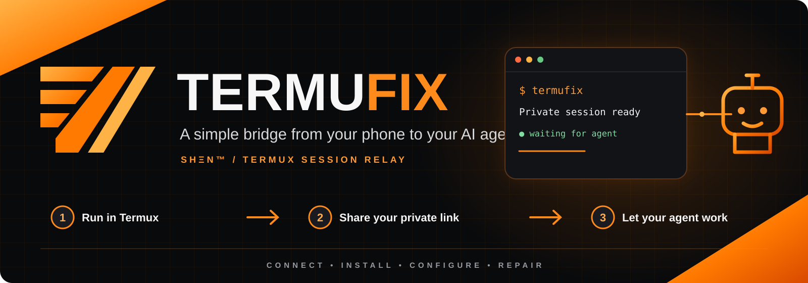

<!-- بنر اصلی -->
<p align="center">
  
</p>

<h1 align="center">TERMUFIX · SHΞN™</h1>
<p align="center" dir="rtl"><strong>پل ساده‌ای برای وصل کردن ایجنت هوش مصنوعی به ترموکس گوشی شما</strong></p>
<p align="center" dir="rtl">
  <a href="https://termufix.pages.dev">ورود به سایت</a>
  &nbsp; | &nbsp;
  <a href="https://github.com/aishervin/Termufix">مخزن پروژه</a>
</p>

---

<h2 dir="rtl" align="right">ترموفیکس چه کاری انجام می‌دهد؟</h2>

<p dir="rtl" align="right">
اگر روی گوشی خود <bdi dir="ltr">Termux</bdi> نصب کرده‌اید، اما کار با دستورها و تنظیمات آن برایتان دشوار است، ترموفیکس به شما کمک می‌کند یک ایجنت هوش مصنوعی یا بات مورداعتماد را به نشست ترموکس وصل کنید.
</p>
<p dir="rtl" align="right">
شما فقط یک دستور آماده را اجرا می‌کنید و لینک خصوصی نشست را به ایجنت می‌دهید. از آن به بعد، ایجنت می‌تواند با اجازهٔ شما وضعیت گوشی را بررسی کند، ابزارهای لازم را نصب کند، تنظیمات را تغییر دهد و خطاها را برطرف کند.
</p>

<h3 dir="rtl" align="right">با ترموفیکس چه کارهایی می‌توان انجام داد؟</h3>
<ul dir="rtl" align="right">
  <li>بررسی وضعیت گوشی، نسخهٔ اندروید و معماری دستگاه؛</li>
  <li>نصب و به‌روزرسانی ابزارها و پیش‌نیازها؛</li>
  <li>تنظیم مخازن بسته‌ها و رفع خطاهای رایج؛</li>
  <li>عیب‌یابی و تعمیر محیط ترموکس یا ابزارهایی مانند <bdi dir="ltr">OpenCode</bdi>؛</li>
  <li>اجرای دستورها و خواندن نتیجه، بدون نیاز به تایپ دستی شما.</li>
</ul>

<p dir="rtl" align="right">
<strong>یک نکته:</strong> ترموفیکس خودش ربات یا هوش مصنوعی نیست؛ فقط یک پل ارتباطی میان نشست ترموکس و ایجنتی است که شما انتخاب می‌کنید.
</p>

---

<h2 dir="rtl" align="right">شروع کار؛ فقط سه مرحله</h2>

<h3 dir="rtl" align="right">مرحلهٔ اول: ساخت لینک اتصال</h3>
<ol dir="rtl" align="right">
  <li>با گوشی وارد <a href="https://termufix.pages.dev">سایت ترموفیکس</a> شوید.</li>
  <li>یک نام دلخواه وارد کنید.</li>
  <li>دکمهٔ ساخت دستور را بزنید و دستور نمایش‌داده‌شده را کپی کنید.</li>
</ol>

<h3 dir="rtl" align="right">مرحلهٔ دوم: اجرای دستور در ترموکس</h3>
<ol dir="rtl" align="right">
  <li>برنامهٔ <bdi dir="ltr">Termux</bdi> را باز کنید.</li>
  <li>دستور کپی‌شده را در صفحهٔ ترمینال بچسبانید.</li>
  <li>دکمهٔ <bdi dir="ltr">Enter</bdi> را بزنید و منتظر بمانید اتصال برقرار شود.</li>
</ol>

<p dir="rtl" align="right">دستور زیر فقط یک نمونه است؛ همیشه دستور اختصاصی‌ای را که سایت به شما می‌دهد اجرا کنید.</p>

```bash
curl -fsSL https://termufix.pages.dev/join/ONE_TIME_TOKEN | bash
```

<p dir="rtl" align="right">
پس از اتصال، یک لینک خصوصی نشست در ترموکس نمایش داده می‌شود. آن را کپی کنید؛ این همان لینکی است که باید به ایجنت بدهید.
</p>

<h3 dir="rtl" align="right">مرحلهٔ سوم: فرستادن لینک برای ایجنت</h3>
<p dir="rtl" align="right">
لینک را در گفت‌وگوی ایجنت یا بات مورداعتماد خود بفرستید. برای شروع می‌توانید متن زیر را هم همراه آن ارسال کنید:
</p>

<blockquote dir="rtl">
این لینک، نشست خصوصی ترموکس من است. ابتدا وضعیت دستگاه و اتصال را بررسی کن. قبل از هر تغییر مهم، توضیح بده چه کاری می‌خواهی انجام بدهی. دستورها را یکی‌یکی اجرا کن، نتیجه را بررسی کن و در پایان خلاصه‌ای از کارهایی که انجام داده‌ای به من بده. اطلاعات محرمانه را نمایش نده و ارسال نکن.
</blockquote>

<p dir="rtl" align="right">
ایجنت باید امکان ارسال درخواست‌های اینترنتی یا <bdi dir="ltr">HTTP</bdi> را داشته باشد. اگر چنین قابلیتی در ابزارهای ایجنت فعال نیست، باید آن را فعال کنید.
</p>

---

<h2 dir="rtl" align="right">اتصال ایجنت چگونه انجام می‌شود؟</h2>
<p dir="rtl" align="right">
لینک نشست، چند مسیر ارتباطی در اختیار ایجنت قرار می‌دهد. معمولاً کاربر عادی نیازی به استفادهٔ مستقیم از آن‌ها ندارد؛ ایجنت این درخواست‌ها را در پشت صحنه ارسال می‌کند.
</p>

<table dir="rtl">
  <thead>
    <tr><th align="right">درخواست</th><th align="right">کاربرد</th></tr>
  </thead>
  <tbody>
    <tr><td><code dir="ltr">GET /state</code></td><td>بررسی وضعیت اتصال و دریافت خروجی آخرین دستور</td></tr>
    <tr><td><code dir="ltr">POST /cmd</code></td><td>فرستادن دستور برای اجرا در ترموکس</td></tr>
    <tr><td><code dir="ltr">POST /close</code></td><td>بستن نشست</td></tr>
  </tbody>
</table>

<h3 dir="rtl" align="right">نمونه برای سازندگان ایجنت و بات</h3>
<p dir="rtl" align="right">برای فرستادن یک دستور، درخواست باید فیلد <code dir="ltr">cmd</code> را در بدنهٔ فرم داشته باشد:</p>

```bash
curl -X POST "SESSION_URL/cmd" \
  -H "content-type: application/x-www-form-urlencoded" \
  --data-urlencode "cmd=pwd && uname -a"
```

<p dir="rtl" align="right">برای خواندن وضعیت و خروجی نشست:</p>

```bash
curl "SESSION_URL/state"
```

<p dir="rtl" align="right">
ایجنت باید پس از فرستادن هر دستور، وضعیت نشست را بررسی کند و منتظر نتیجهٔ همان دستور بماند. در هر نشست، دستورها یکی‌یکی اجرا می‌شوند و اجرای هم‌زمان چند دستور پشتیبانی نمی‌شود.
</p>

---

<h2 dir="rtl" align="right">امنیت؛ لینک نشست را محرمانه نگه دارید</h2>
<ul dir="rtl" align="right">
  <li><strong>لینک نشست مانند رمز عبور است.</strong> هرکس لینک کامل را داشته باشد می‌تواند دستور بفرستد و خروجی را ببیند.</li>
  <li>لینک را فقط برای ایجنت یا فردی بفرستید که به او اعتماد دارید؛ آن را در گروه‌ها و کانال‌های عمومی منتشر نکنید.</li>
  <li>دستورها با سطح دسترسی همان کاربر ترموکس اجرا می‌شوند. ترموفیکس به‌خودی‌خود دسترسی روت ایجاد نمی‌کند.</li>
  <li>پیش از حذف فایل‌ها، تغییر تنظیمات حساس یا نصب نرم‌افزار ناشناس، از ایجنت بخواهید دلیل و اثر کار را توضیح دهد.</li>
  <li>پس از پایان کار، نشست را ببندید و لینک آن را دیگر به اشتراک نگذارید.</li>
</ul>

---

<h2 dir="rtl" align="right">اگر اتصال برقرار نشد</h2>
<ul dir="rtl" align="right">
  <li><strong>دستور اجرا نمی‌شود:</strong> دستور را کامل از سایت کپی کنید و اتصال اینترنت گوشی را بررسی کنید.</li>
  <li><strong>خطای نبودن <code dir="ltr">curl</code>:</strong> در ترموکس دستور زیر را اجرا کنید و دوباره تلاش کنید.</li>
</ul>

```bash
pkg install curl -y
```

<ul dir="rtl" align="right">
  <li><strong>نشست آفلاین است:</strong> ترموکس را باز نگه دارید و مطمئن شوید اندروید اجرای پس‌زمینهٔ آن را متوقف نکرده است.</li>
  <li><strong>دستور قبلی هنوز تمام نشده:</strong> کمی صبر کنید و دوباره وضعیت نشست را بررسی کنید.</li>
  <li><strong>لینک نامعتبر یا منقضی شده:</strong> به سایت برگردید و یک دستور اتصال تازه بسازید.</li>
</ul>

<p dir="rtl" align="right">
برای حفظ اتصال، گوشی باید اینترنت داشته باشد و اجازهٔ فعالیت پس‌زمینه به ترموکس داده شده باشد. محدودیت باتری بعضی گوشی‌ها ممکن است اتصال را متوقف کند.
</p>

---

<h2 dir="rtl" align="right">برای توسعه‌دهندگان</h2>
<p dir="rtl" align="right">
اگر در حال ساخت بات یا ایجنت هستید، برای اتصال به ترموفیکس کافی است امکان ارسال درخواست <bdi dir="ltr">HTTP</bdi> داشته باشید. ایجنت باید لینک محرمانه را دریافت کند، وضعیت را بخواند، دستور را ارسال کند، نتیجه را بررسی کند و در پایان نشست را ببندد.
</p>
<p dir="rtl" align="right">
<strong>نشانی سرویس:</strong>
<a href="https://termufix.pages.dev"><bdi dir="ltr">https://termufix.pages.dev</bdi></a>
</p>

<hr>

<p align="center" dir="rtl">
  <strong>TERMUFIX · SHΞN™</strong><br>
  یک دستور از شما؛ یک پل ارتباطی برای ایجنت شما.
</p>
